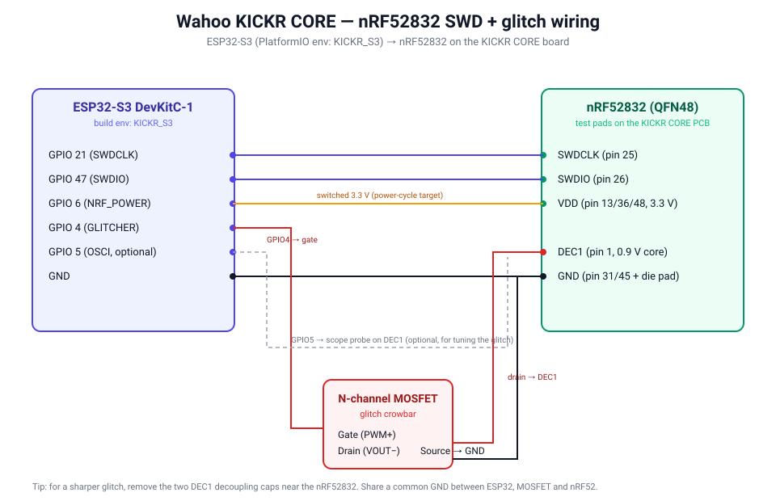

# Wahoo KICKR CORE — nRF52 dump & serial patch

Tools to read out, patch and re-flash the internal firmware of the
**Wahoo KICKR CORE** smart trainer, which is built around a Nordic
**nRF52832**. It lets you work on a device **you own**: recover from a bad
state, change the stored serial number / ANT+ device ID, or study the firmware.

This repo contains two parts:

| Part | What it does |
|------|--------------|
| [`ESP32_nRF52_SWD/`](ESP32_nRF52_SWD/) | ESP32-based SWD flasher + APPROTECT glitcher. Reads and writes the nRF52 flash over SWD. Vendored from the upstream project (GPLv3) — see credits. |
| [`patch_serial.py`](patch_serial.py) | Reads a flash dump and writes back a copy with a new serial number and/or ANT+ device ID. |

A sanitized firmware image, [`flash_template.bin`](flash_template.bin), and the
matching [`uicr.bin`](uicr.bin) are included so you can see the layout and have a
reference image. **The serial number and ANT+ ID in the template are erased**
(`0xFFFFFFFF`); patch in your own values before flashing.

> ⚠️ This is Wahoo's proprietary firmware. The template is provided for use on
> your own hardware only. It is not an official release and is not endorsed by
> or affiliated with Wahoo Fitness.

## How the identity is stored

The trainer keeps its identity in one flash page at `0x78000`, six little-endian
`uint32`:

```
+0x00  unused (0xFFFFFFFF)
+0x04  ANT+ device number (1..65534; 0xFFFFFFFF/0 -> firmware picks a random one)
+0x08  byte 0 = factory flag, rest unused
+0x0C  serial number (shown as "%09u" over BLE, "40%09u" in the Wahoo app)
```

## Workflow

### 1. Build the ESP32 glitcher

See [`ESP32_nRF52_SWD/README.md`](ESP32_nRF52_SWD/README.md) for the
required hardware and build instructions (PlatformIO). It flashes an ESP32 that
talks SWD to the nRF52 and can bypass the readout protection (APPROTECT) by
voltage glitching.

### Wiring



The diagram matches the `KICKR_S3` PlatformIO env (ESP32-S3) used in this repo.
Pins are set in [`ESP32_nRF52_SWD/platformio.ini`](ESP32_nRF52_SWD/platformio.ini).

| ESP32-S3 (env `KICKR_S3`) | nRF52832 signal | nRF52832 QFN48 pin | Purpose |
|---|---|---|---|
| GPIO 21 (`swd_clock_pin`) | SWDCLK | 25 | SWD clock |
| GPIO 47 (`swd_data_pin`)  | SWDIO  | 26 | SWD data |
| GPIO 6 (`NRF_POWER`)      | VDD (3.3 V) | 13 / 36 / 48 | switched supply, lets the ESP32 power-cycle the target |
| GPIO 4 (`GLITCHER`)       | → MOSFET gate | — | drives the N-channel MOSFET |
| MOSFET drain (VOUT−)      | DEC1 (0.9 V core) | 1 | glitch injection point (crowbar to GND) |
| MOSFET source            | GND | 31 / 45 + die pad | common ground |
| GND                      | GND | 31 / 45 + die pad | common ground |
| GPIO 5 (`OSCI_PIN`)       | DEC1 (scope probe) | 1 | optional, for tuning the glitch |

> The classic plain-ESP32 wiring (SWDCLK = GPIO 21, SWDIO = GPIO 19, glitch MOSFET
> on GPIO 5) is documented in the subfolder README. On the KICKR CORE, locate the
> SWDIO / SWDCLK / GND / VDD / DEC1 pads near the nRF52832 on the PCB. For a sharper
> glitch, remove the two DEC1 decoupling caps next to the chip. nRF52832 pin numbers
> are from the [Nordic datasheet](https://docs.nordicsemi.com/r/bundle/ps_nrf52832/page/pin.html).

### Video

Walkthrough of this process: <https://youtu.be/iI3lOkicrSI>

### 2. Dump YOUR OWN trainer

Connect the ESP32 to the nRF52 SWD pins as described there, open the ESP32's web
UI, and read out the flash and UICR. Save them as `flash.bin` (512 KB) and
`uicr.bin` (4 KB) next to `patch_serial.py`.

`flash.bin` is `.gitignore`d on purpose — it carries *your* serial number, so
never commit it.

### 3. Inspect and patch

```bash
# show the serial / ANT+ ID currently in a dump
python3 patch_serial.py --in flash.bin

# set a new serial (the digits after the leading "40" the app shows)
python3 patch_serial.py 211002195 --in flash.bin

# also set the ANT+ device ID
python3 patch_serial.py 211002195 --ant 12345 --in flash.bin
```

With no `--in` it reads the shipped `flash_template.bin`. It writes
`flash_patched.bin` and `kickr_core_patched.hex` (flash + UICR, Intel HEX);
the input dump is never modified.

### 4. Flash back

Write `flash_patched.bin` (or `kickr_core_patched.hex`) back to the nRF52 with
the same ESP32 SWD tool, then power-cycle the trainer.

## Requirements

- Python 3 (standard library only — no dependencies)
- An ESP32 dev board + the glitcher hardware (see the subfolder README)

## Legal & safety

- Use this only on a device **you own**. Changing a serial number to impersonate
  another device, evade warranty/service checks or defeat anti-fraud measures is
  not the intent here and may be illegal where you live.
- SWD glitching can brick the device. You do this at your own risk.
- Wahoo, KICKR and CORE are trademarks of Wahoo Fitness. This project is
  independent and unofficial.

## Credits

- ESP32 SWD flasher / nRF52 APPROTECT glitcher: **atc1441** —
  <https://github.com/atc1441/ESP32_nRF52_SWD> (GPLv3). Vendored here with its
  original LICENSE and README preserved.
- Serial-patch tooling and KICKR CORE identity-layout notes: this repo.

## License

The ESP32 glitcher retains its upstream **GPLv3** license
([`ESP32_nRF52_SWD/LICENSE`](ESP32_nRF52_SWD/LICENSE)). `patch_serial.py` and
the rest of this repo are released under GPLv3 as well — see [`LICENSE`](LICENSE).
